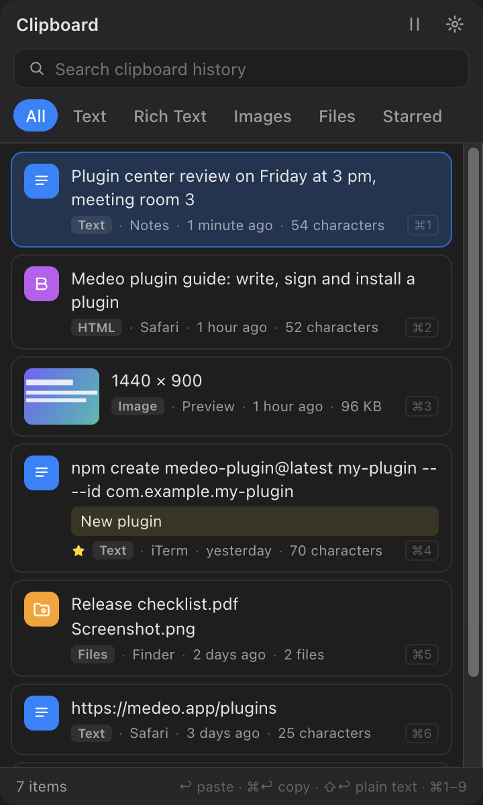

# Clipboard

Keeps everything you copy on this Mac — plain text, rich text, images and files — so you can find it again and paste it where you are.

## Open it

- Click the menu bar icon, or press **⌥C** anywhere.
- Type to search; filter by Text, Rich text, Images, Files or Favorites.

## Paste

| Key | Action |
| --- | --- |
| `↩` | Paste into the app you were in |
| `⌘↩` | Copy only |
| `⇧↩` | Paste as plain text |
| `⌘1`–`⌘9` | Paste one of the first nine items |

## Favorites and notes

Star the snippets you reuse and add a note to find them by. Clearing the history keeps your favorites.

## Privacy

History stays on this Mac, in the plugin's own storage. You can pause recording at any time from the panel or with the **Pause or Resume Recording** command; uninstalling the plugin removes its history.

## Permissions

Runs as a Node plugin (asked separately at install) to read the system clipboard and paste into other apps; it also uses a global shortcut, a menu bar item and its own window.
