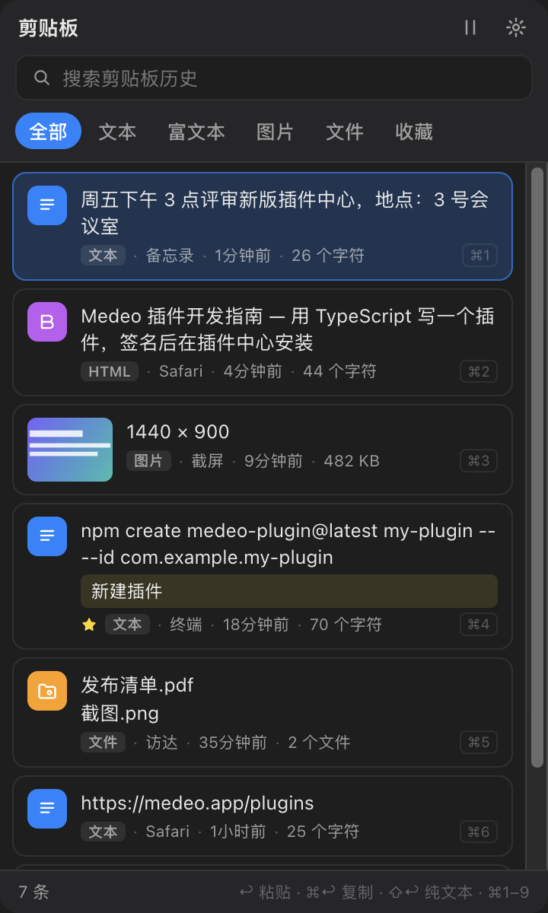

# 剪贴板

记住你在这台 Mac 上复制过的一切：文本、富文本、图片和文件。随时找回，直接粘贴到当前 App。

## 打开

- 点菜单栏图标，或在任何地方按 **⌥C**。
- 输入关键词搜索；可按 文本、富文本、图片、文件、收藏 筛选。

## 粘贴

| 按键 | 作用 |
| --- | --- |
| `↩` | 粘贴到刚才的 App |
| `⌘↩` | 只复制 |
| `⇧↩` | 以纯文本粘贴 |
| `⌘1`–`⌘9` | 粘贴前九条中的一条 |

## 收藏与备注

常用的片段点星收藏，还可以加备注方便搜索。清空历史时收藏的内容会保留。

## 隐私

历史只保存在这台 Mac 上、插件自己的存储里。可以在面板里或用「暂停或继续记录」命令随时暂停记录；卸载插件会一并删除历史。

## 权限

以 Node 插件运行（安装时需要单独确认），用来读取系统剪贴板并粘贴到其他 App；另外会用到全局快捷键、菜单栏图标和独立窗口。
