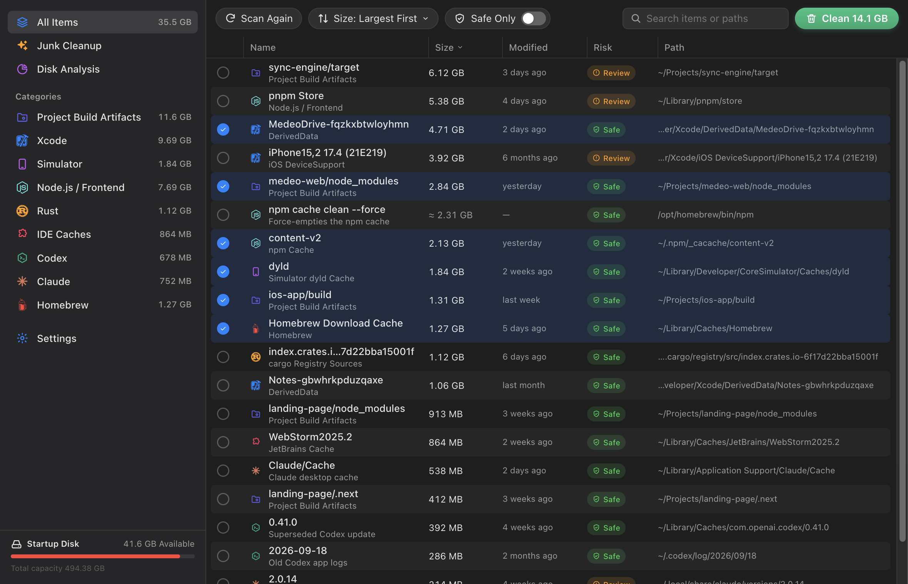
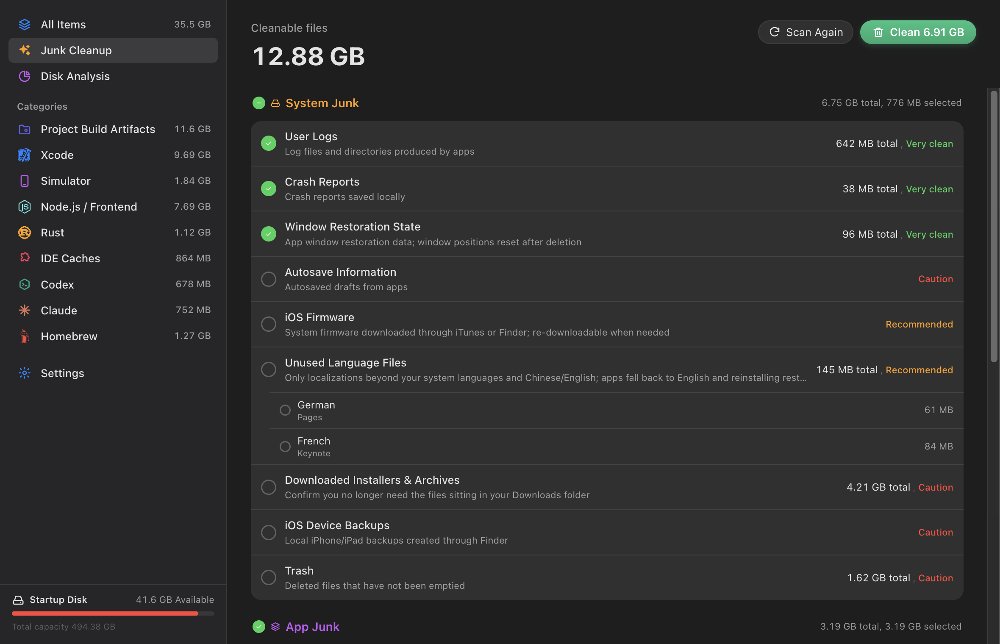

# Mac Cleaner

Finds caches, logs and leftovers on your Mac, shows what fills your disk, and moves only what you choose to the Trash.

## What it looks at

- **System and app caches**, browser caches, app leftovers and unused language packs
- **Developer caches**: Xcode, simulators, Homebrew, Node.js, Python, Rust, Go, Flutter, CocoaPods, Android / Gradle, IDEs
- **AI tools**: Claude and Codex caches, logs and old versions
- **Project build output** such as `node_modules`, `build` and `Pods`
- Old installers and archives in Downloads, and the Trash itself

## Safe by default

- Scanning only reads; nothing is removed until you confirm.
- Removed items go to the **Trash**, so you can put them back.
- An app that is still running is skipped until you quit it.

## Permissions

Runs as a Node plugin (asked separately at install) so it can measure folders across your Mac; it keeps its settings in the plugin's own storage.
