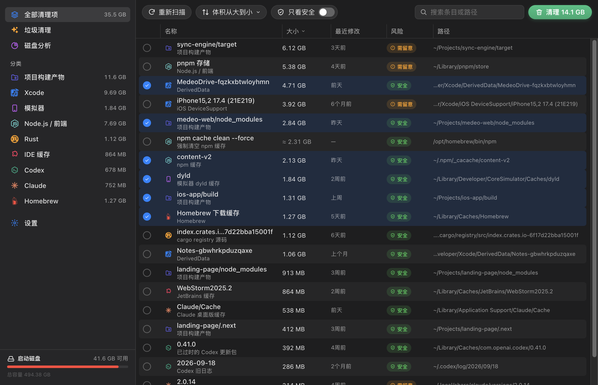
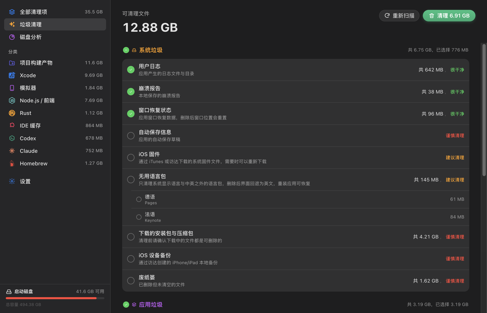

# Mac 清理

找出 Mac 上的缓存、日志和残留文件，告诉你磁盘被什么占满了，只把你选中的移到废纸篓。

## 会检查哪些地方

- **系统与应用缓存**、浏览器缓存、应用残留、无用语言包
- **开发缓存**：Xcode、模拟器、Homebrew、Node.js、Python、Rust、Go、Flutter、CocoaPods、Android / Gradle、IDE
- **AI 工具**：Claude 与 Codex 的缓存、日志和旧版本
- **项目构建产物**：`node_modules`、`build`、`Pods` 等可重新生成的内容
- 下载目录里的旧安装包和压缩包，以及废纸篓本身

## 默认安全

- 扫描只读取，不确认就不会删除任何东西。
- 清理的内容进入**废纸篓**，随时可以放回原处。
- 仍在运行的 App 会先跳过，退出后才清理。

## 权限

以 Node 插件运行（安装时需要单独确认），以便统计整台 Mac 上的文件夹大小；设置保存在插件自己的存储里。
