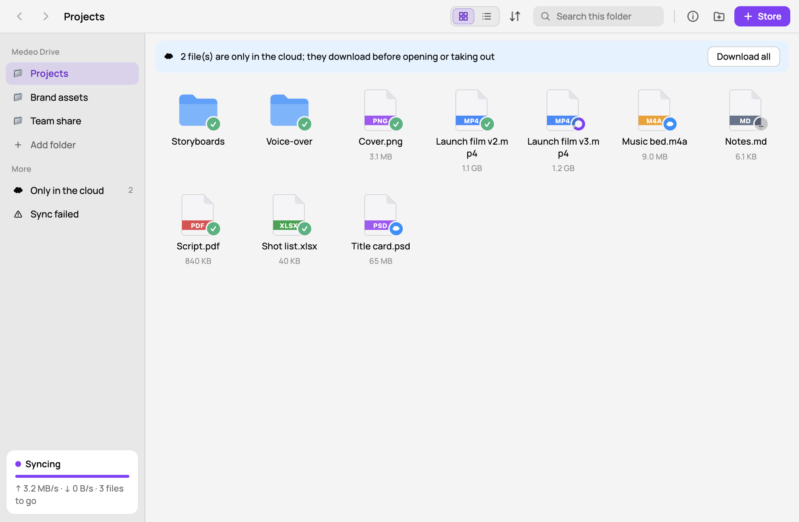
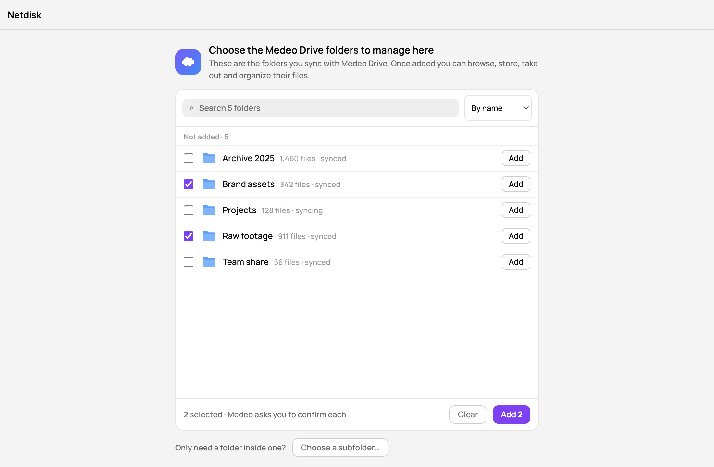
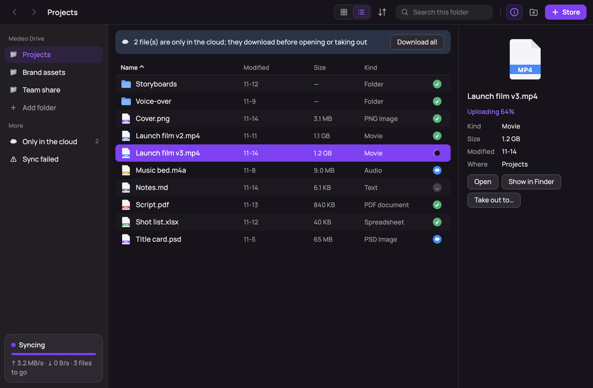

# Netdisk

Browse the folders you sync with Medeo Drive and manage their files like in Finder: store files by
dragging them in, take them out by dragging them to Finder, and see at a glance what is synced,
still uploading or only in the cloud.

## Get started

Open Netdisk from the plugin center or the launcher and choose which Medeo Drive folders to manage
here. Medeo asks you to confirm each one; the plugin only sees the folders you add. **Choose a
subfolder…** adds just one folder inside a drive folder.

## Browse and organize

- Icon or list view per folder (⌘1 / ⌘2), sort by name, date, size or kind, and search the current folder (⌘F).
  ⌘P jumps to another added folder; ⌘[ / ⌘] go back and forward.
- New folder, rename, open, show in Finder, and **Move to Trash** (it is removed from Medeo Drive too,
  and the confirmation says so).
- ⌘I shows a file's details: kind, size, modified date, where it is and its sync state.

## Store and take out

- **Store**: drag files from Finder into the window, or use **＋ Store**. A name that is already taken
  keeps both files. Medeo uploads them to the cloud on its own.
- **Take out**: drag files to Finder, or **Take out to…** to copy them to a folder you pick.

## Sync state

Every file shows a badge: synced, waiting, uploading (with progress), only in the cloud, or failed.
Files that are only in the cloud download before they open or go out (**Download all** does a whole
folder). The sidebar shows the upload and download speed and how many files are left, and **Sync
failed** lists failures with their reason and a retry.

## From other plugins

Netdisk receives what other plugins send to Medeo Drive: **Send to… › Store to Medeo Drive** in the launcher,
and the cloud button in Screenshot and Clipboard. Files, images, text (saved as a `.txt`) and links
(saved as a `.webloc`) are accepted. The first time, a small window asks which folder to store in;
tick **Store here directly next time** to skip it next time (**Store to Medeo Drive…** always asks). A
notification says where it went and when it has reached the cloud.

## Requirements and permissions

Medeo 0.1.46 or later on macOS, signed in, with at least one Medeo Drive folder. Runs in the
sandbox (no Node access). Permissions: `drive_read` and `drive_manage` (folders, sync state,
downloads and retries), `file_access` (only the drive folders you add), `app_windows`,
`notifications` and `storage` (your view settings and remembered folders).
