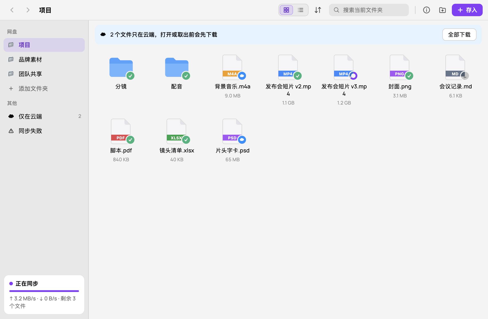
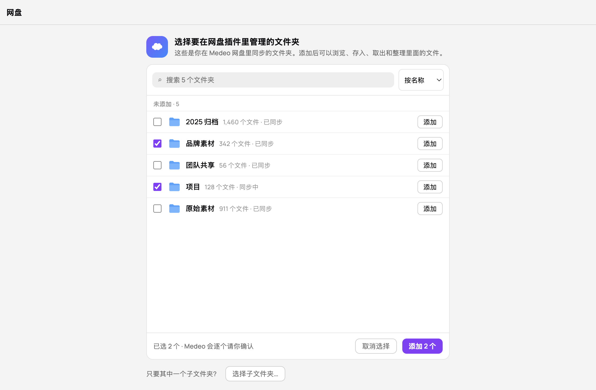
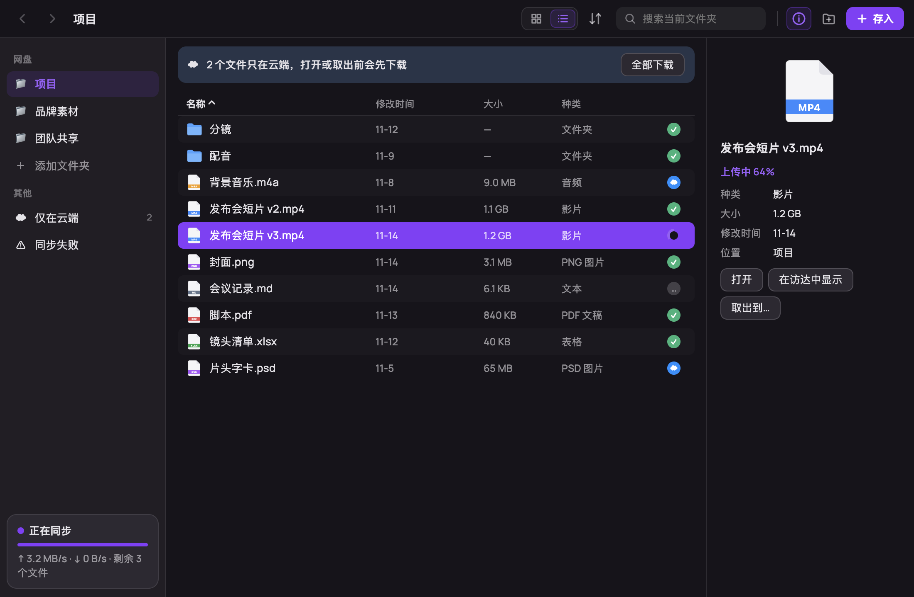

# 网盘

浏览你在 Medeo 网盘里同步的文件夹，像在访达里一样管理文件：把文件拖进来存入，拖到访达取出，
一眼看出哪些已同步、哪些还在上传、哪些只在云端。

## 开始使用

从插件中心或启动器打开网盘，选择要在这里管理的网盘文件夹。Medeo 会逐个请你确认，插件只能看到你添加的文件夹。
只需要其中某个子文件夹时，点 **选择子文件夹…**。

## 浏览与整理

- 每个文件夹可分别用图标或列表显示（⌘1 / ⌘2），按名称、修改时间、大小、种类排序，⌘F 搜索当前文件夹。
  ⌘P 切换到其他已添加的文件夹，⌘[ / ⌘] 后退、前进。
- 新建文件夹、重命名、打开、在访达中显示、**移到废纸篓**（网盘里也会一起删除，确认框会说明）。
- ⌘I 显示文件详情：种类、大小、修改时间、位置和同步状态。

## 存入与取出

- **存入**：从访达把文件拖进窗口，或点 **＋ 存入**。重名时两个文件都会保留。存好后 Medeo 会自动上传到云端。
- **取出**：把文件拖到访达，或用 **取出到…** 复制到你选的文件夹。

## 同步状态

每个文件都带状态标记：已同步、等待中、上传中（带进度）、仅在云端、同步失败。仅在云端的文件会在打开或取出前先下载，
**全部下载** 可以一次下载整个文件夹。侧栏显示上传、下载速度和剩余文件数；**同步失败** 列出失败的文件和原因，可以重试。

## 接收其他插件的内容

其他插件发到 Medeo 网盘的内容都由网盘接收：启动器里的 **发送到… › 存到网盘**，以及截图、剪贴板里的云按钮。
支持文件、图片、文字（存成 `.txt`）和链接（存成 `.webloc`）。第一次会弹出一个小窗口问存到哪个文件夹，
勾选 **以后直接存到这里** 下次就不再问（**存到网盘…** 每次都会问）。存好和上传到云端后会有通知。

## 要求与权限

需要 macOS 上的 Medeo 0.1.46 或更高版本，已登录，并且至少有一个网盘同步文件夹。在沙盒里运行（不使用 Node）。
权限：`drive_read`、`drive_manage`（文件夹、同步状态、下载与重试）、`file_access`（只限你添加的网盘文件夹）、
`app_windows`、`notifications`、`storage`（保存视图设置和记住的文件夹）。
