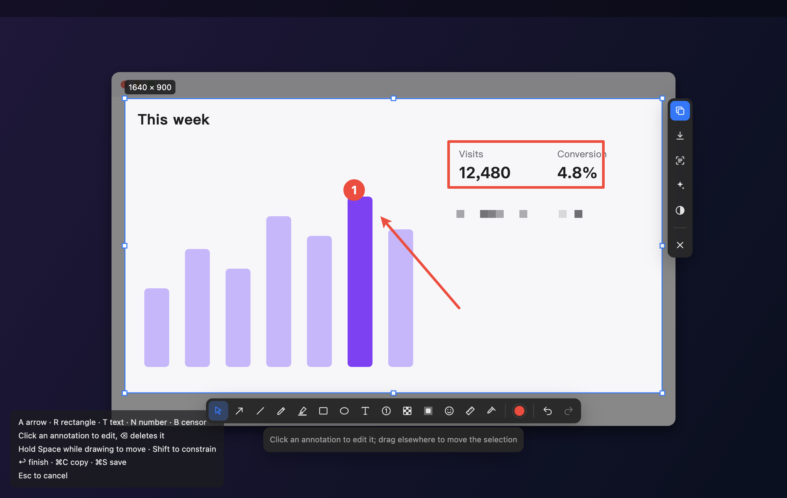
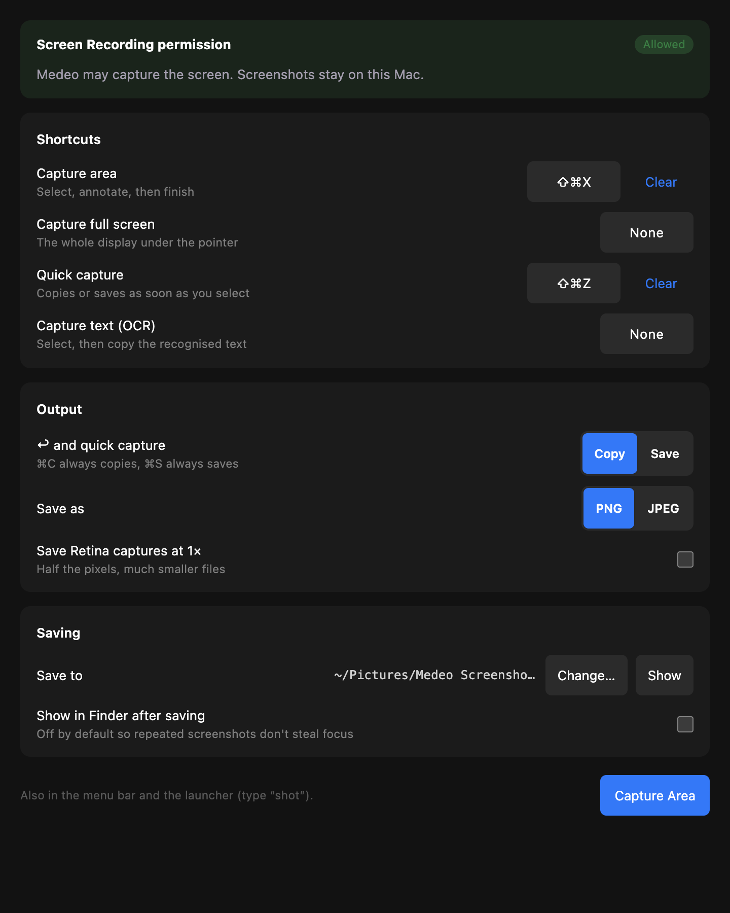

# Screenshot

Capture any part of the screen and annotate it in place: select, add arrows, blur, number the
steps, then copy or save in one go.

- **Capture**: ⌘⇧X (area), plus optional shortcuts for full screen, quick capture and OCR; the
  menu-bar icon and the launcher (`shot`). The display under the pointer is frozen with macOS's
  `screencapture`; drag to select (Shift for a square), click a window (Tab toggles snapping), F
  for the whole display.
- **Tools** (single-key shortcuts): Select S, Arrow A (5 styles), Line L, Pencil P, Marker M,
  Rectangle R / Ellipse O (outline, fill, corner radius), Text T (bold, italic, underline,
  alignment, background), Number N (1/I/A/a), Censor B (pixelate, blur, solid), Highlight H,
  Stamp G, Measure U, Color sampler I. Click any annotation to edit, move, resize or delete it;
  hold Space while drawing to move, Shift to constrain.
- **Actions**: copy ⌘C, save ⌘S (PNG or JPEG, optional 1×), read text and QR codes with Apple
  Vision, beautify (gradient, padding, window frame), invert.

Runtime: Node (macOS). Permissions: `node`, `app_windows`, `window_management` (the full-screen
overlay), `screen_capture` (reports and requests macOS Screen Recording), `global_shortcuts`,
`tray`, `notifications`. AppKit access goes through `resources/helper.js`, run with
`osascript -l JavaScript`; no native binaries are shipped.

Not yet: pin to screen (needs a floating window type in the host), scroll capture, recording,
multi-display selections.
