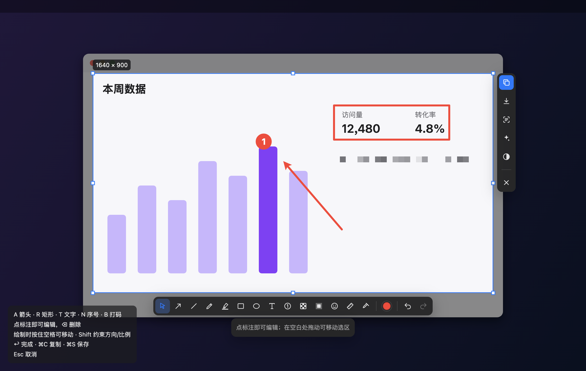
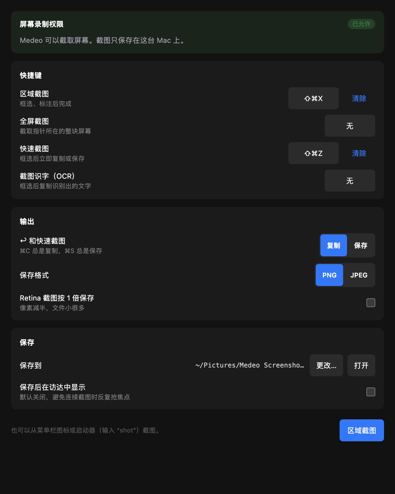

# 截图

截取屏幕任意区域并就地标注：框选、画箭头、打码、加序号，复制或保存一气呵成。

- **截图**：⌘⇧X 区域截图；全屏、快速截图、截图识字（OCR）可另设快捷键；也可从菜单栏图标和启动器（输入 `shot`）调用。
  用系统 `screencapture` 冻结指针所在屏幕；拖拽框选（Shift 正方形）、单击选中窗口（Tab 开关吸附）、F 选整个屏幕。
- **工具**（单键切换）：选择 S、箭头 A（5 种）、直线 L、铅笔 P、马克笔 M、矩形 R / 椭圆 O（描边、填充、圆角）、
  文字 T（粗体、斜体、下划线、对齐、背景）、序号 N（1/I/A/a）、打码 B（像素化、模糊、色块）、聚光 H、贴纸 G、测量 U、取色 I。
  点任意标注即可编辑、移动、缩放或删除；绘制时按住空格移动，Shift 约束。
- **动作**：复制 ⌘C、保存 ⌘S（PNG/JPEG，可按 1 倍保存）、用 Apple Vision 识别文字和二维码、美化（渐变、留白、窗口边框）、反色。

运行时：Node（macOS）。权限：`node`、`app_windows`、`window_management`（全屏覆盖层）、`screen_capture`
（报告并申请系统屏幕录制授权）、`global_shortcuts`、`tray`、`notifications`。AppKit 能力经 `resources/helper.js`
（`osascript -l JavaScript`）调用，不带原生二进制。

暂未支持：贴图（需宿主提供置顶浮窗）、滚动长截图、录屏、跨屏选区。
