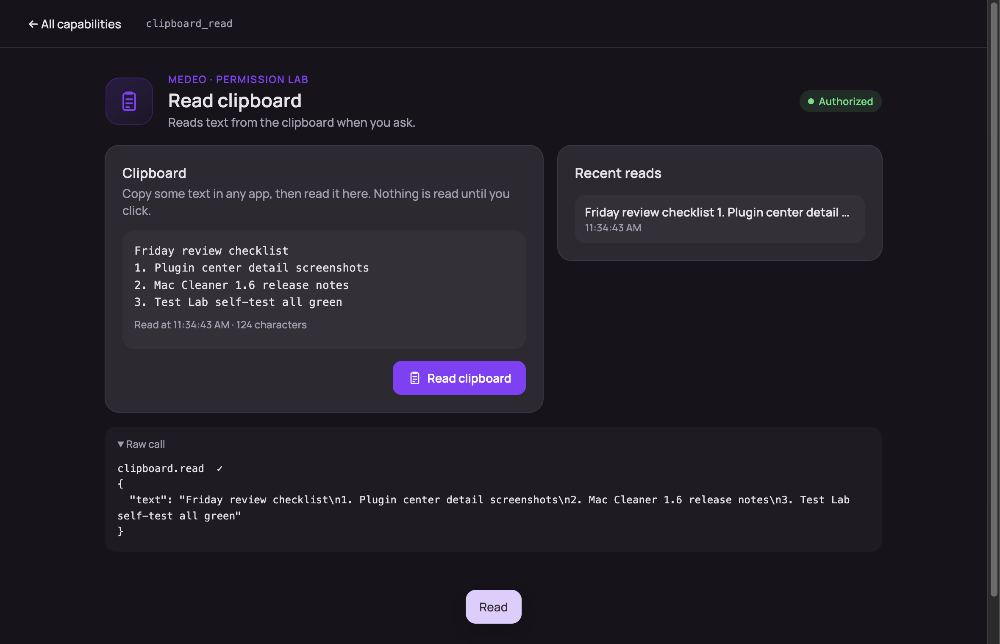

# Test Lab

A workbench for trying every capability Medeo gives plugins — one tab per permission.

Each tab shows whether Medeo and macOS have granted the permission, lets you call its methods with your own arguments, and logs every call and event. Dedicated pages cover the richer ones: chat with the agent API, screen and audio recording, the launcher, the phrase input method, notifications, menu bar, shortcuts, windows and files.

Use it to check what a permission does before you build with it, or to verify a Medeo build. It asks for many permissions on purpose; grant only the ones you want to try, and revoke them any time in the plugin center.
