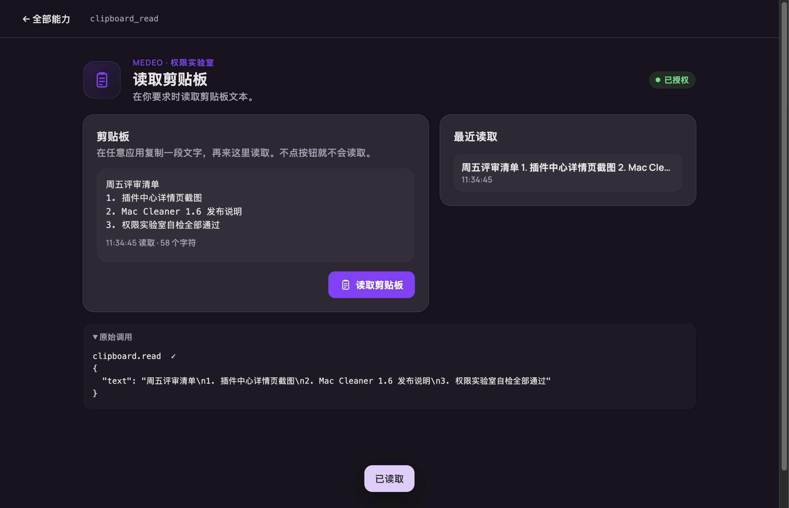

# 测试实验室

体验 Medeo 提供给插件的每一项能力的工作台：每个权限一个页签。

每个页签会显示 Medeo 和 macOS 是否已授权，可以用你自己的参数调用相应方法，并记录每一次调用和事件。功能较多的能力有专门页面：Agent 对话、屏幕与音频录制、启动器、短语输入法、通知、菜单栏、快捷键、窗口和文件。

开发插件前可以先用它看看某个权限能做什么，也可以用来验收 Medeo 版本。它有意申请了很多权限，只授权你想试的即可，随时可以在插件中心撤销。
