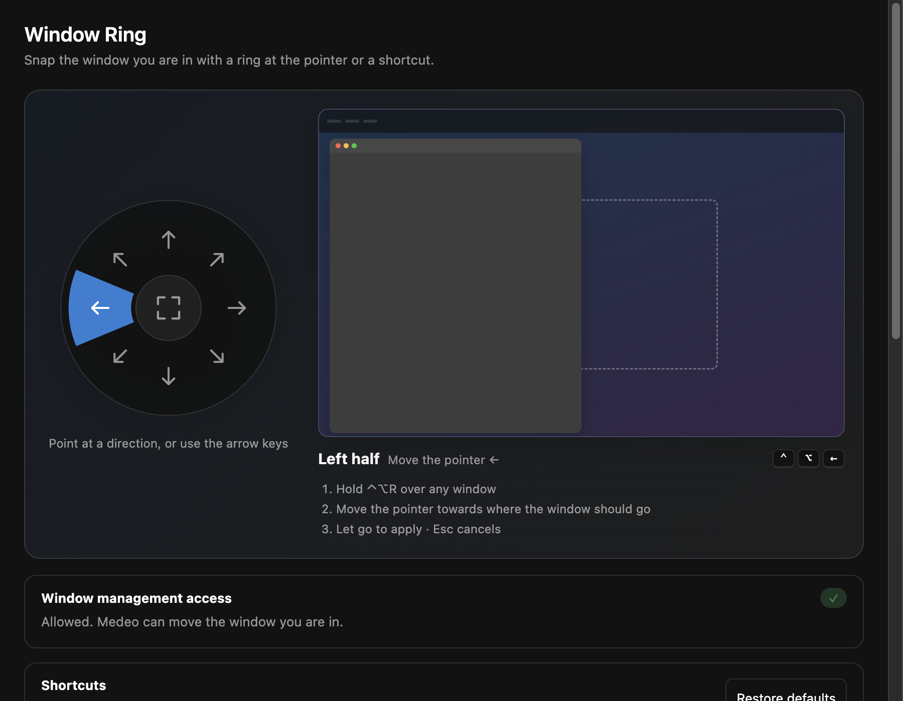
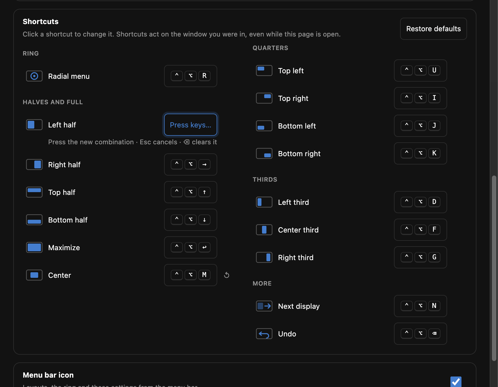

# Window Ring

Move and resize the window you are in with a ring at the pointer or a keyboard shortcut: halves, quarters, thirds, maximize, center and the next display, with a live preview, size cycles and undo.

## The ring

Hold **⌃⌥R** over any window. A ring opens at the pointer: move towards one of the eight directions to preview halves and quarters, stay in the middle to maximize. Let go to apply; Esc cancels. The window goes to the display under the pointer.

The plugin's page has the same ring as a diagram: point at a direction, or use the arrow keys, to see what it does.

## Shortcuts

| Keys | Layout |
| --- | --- |
| `⌃⌥←` `⌃⌥→` `⌃⌥↑` `⌃⌥↓` | Halves (press ← or → again: ½ → ⅔ → ⅓) |
| `⌃⌥↩` | Maximize (again: almost maximize) |
| `⌃⌥C` | Center |
| `⌃⌥U` `⌃⌥I` `⌃⌥J` `⌃⌥K` | Quarters |
| `⌃⌥D` `⌃⌥F` `⌃⌥G` | Thirds |
| `⌃⌥N` | Next display |
| `⌃⌥⌫` | Undo |

Click any shortcut on the plugin's page to change it. Keys already used by another app, another plugin or a Medeo shortcut are refused with the reason; ↺ restores the default.

## Menu bar

The menu-bar icon offers the ring, the common layouts with their keys, and the settings. It can be hidden from its menu or the plugin's page.

## Permissions

Window management (macOS Accessibility, to move other apps' windows), global shortcuts, the menu-bar icon, its own windows, and storage for the shortcuts you change. Full-screen and minimized windows are left alone; Medeo's own windows are never moved.
