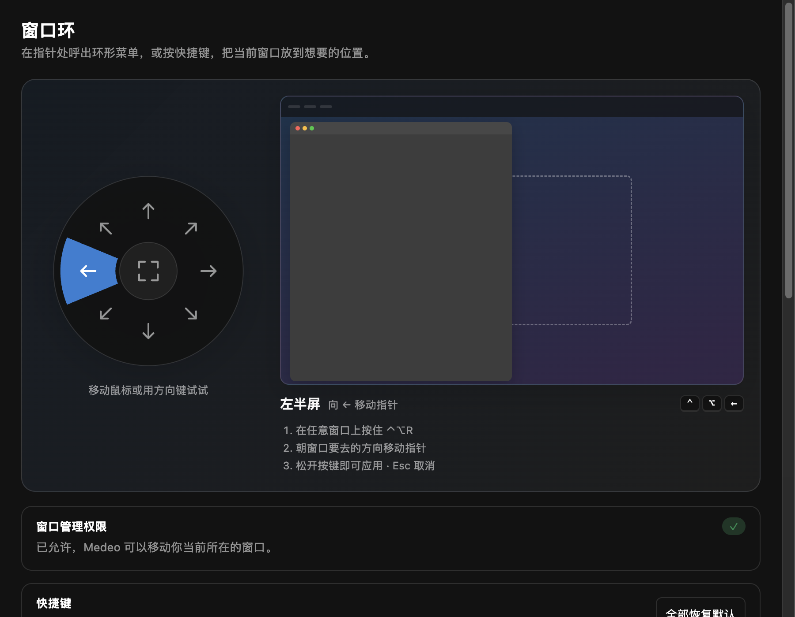
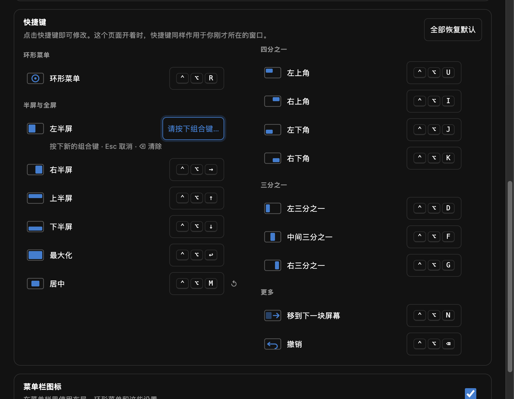

# 窗口环

用指针处的环形菜单或快捷键移动、缩放当前窗口：半屏、四分之一、三分之一、最大化、居中、移到下一块屏幕，带实时预览、循环切换和撤销。

## 环形菜单

在任意窗口上按住 **⌃⌥R**，指针处出现环形菜单：朝八个方向之一移动即可预览半屏和四分之一，停在中心为最大化。松开按键应用，Esc 取消。窗口会放到指针所在的屏幕。

插件页面里有同样的圆环示意图：把鼠标移到某个方向，或用方向键，就能看到它的效果。

## 快捷键

| 按键 | 布局 |
| --- | --- |
| `⌃⌥←` `⌃⌥→` `⌃⌥↑` `⌃⌥↓` | 半屏（再按 ← 或 →：½ → ⅔ → ⅓） |
| `⌃⌥↩` | 最大化（再按：接近最大化） |
| `⌃⌥C` | 居中 |
| `⌃⌥U` `⌃⌥I` `⌃⌥J` `⌃⌥K` | 四个角 |
| `⌃⌥D` `⌃⌥F` `⌃⌥G` | 三分之一 |
| `⌃⌥N` | 移到下一块屏幕 |
| `⌃⌥⌫` | 撤销 |

在插件页面点击任意快捷键即可修改。已被其他应用、其他插件或 Medeo 快捷键占用的组合会被拒绝并说明原因；↺ 恢复默认。

## 菜单栏

菜单栏图标里可以打开环形菜单、使用常用布局（标有快捷键）和进入设置；可在菜单或插件页面里隐藏。

## 权限

窗口管理（macOS 辅助功能，用于移动其他应用的窗口）、全局快捷键、菜单栏图标、插件自己的窗口，以及保存你修改的快捷键所需的存储。全屏和最小化的窗口不会被改动；Medeo 自己的窗口永远不会被移动。
